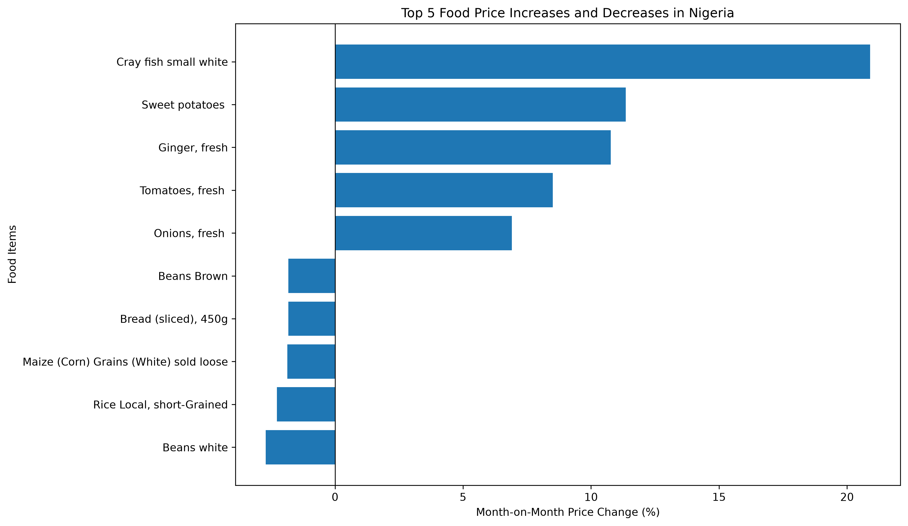
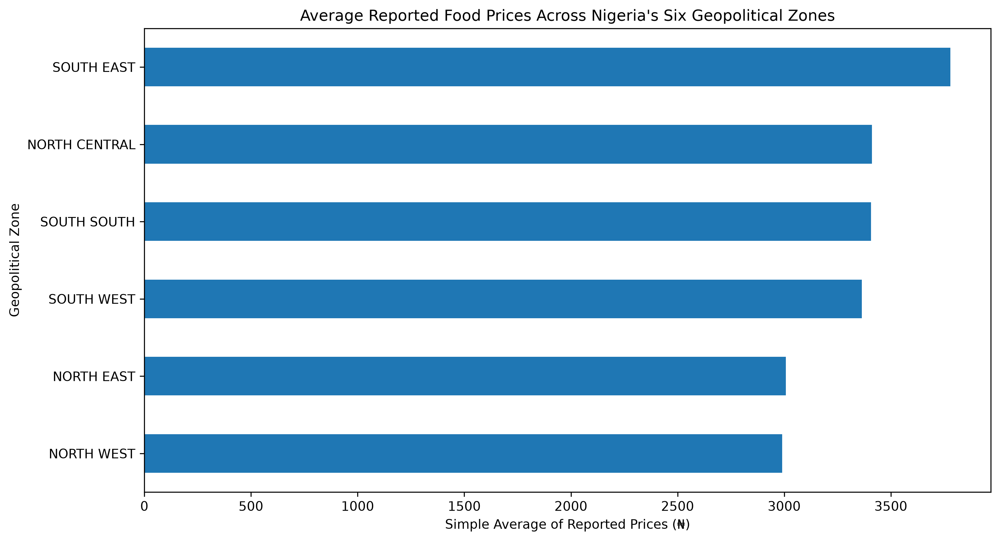
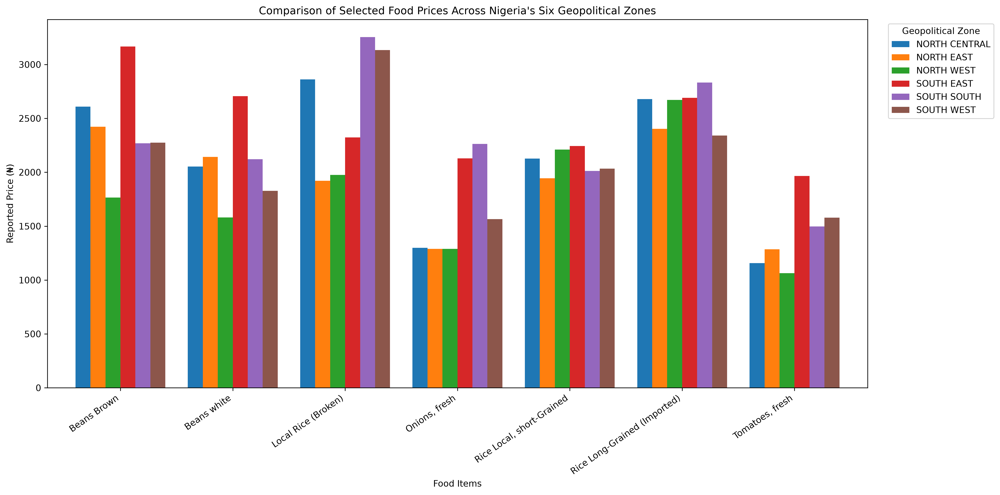
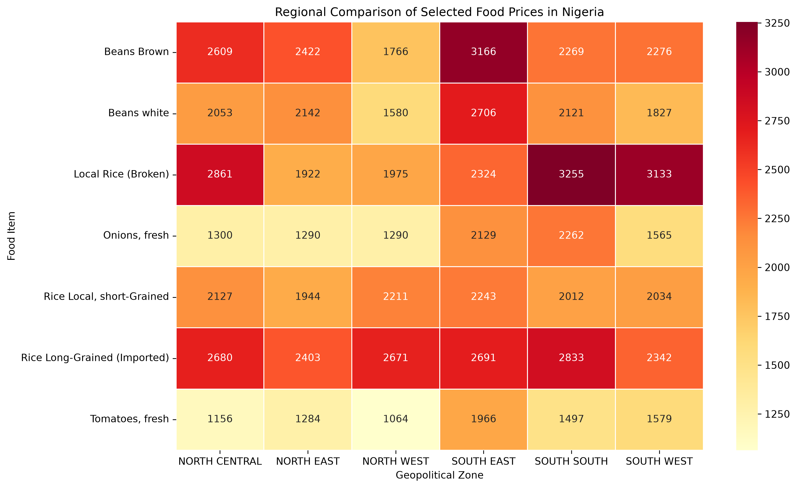
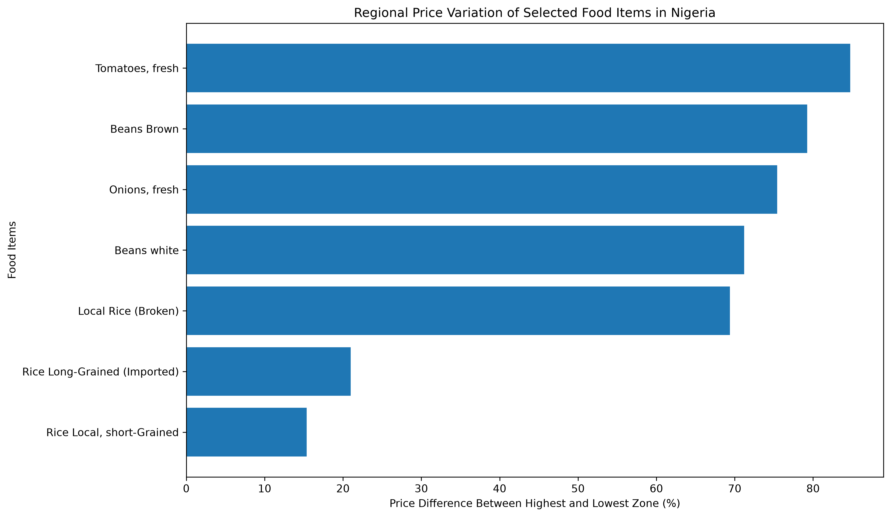
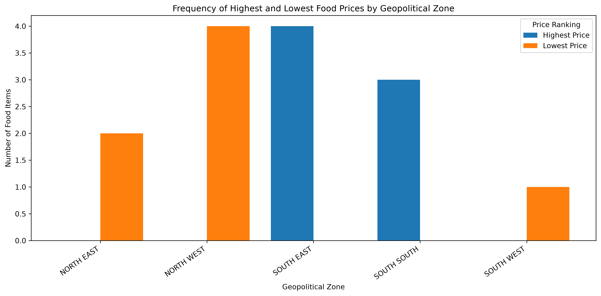

# Nigerian Economic Data Explorer

## Project Overview

The Nigerian Economic Data Explorer is a data analysis project focused on examining food price movements across Nigeria using data published by the National Bureau of Statistics (NBS).

The project uses the **May 2025 Selected Food Price Watch** dataset to investigate national food price changes, compare food prices across Nigeria's six geopolitical zones, and identify regional differences in the prices of selected food items.

Python was used to clean, validate, analyse, and visualise the dataset, with the aim of turning raw economic data into meaningful insights.

## Project Objectives

The main objectives of this project are to:

1. Analyse month-on-month food price movements in Nigeria.
2. Identify food items with the highest price increases and decreases.
3. Compare average reported food prices across Nigeria's six geopolitical zones.
4. Examine regional price differences for selected food items.
5. Identify the geopolitical zones recording the highest and lowest prices.
6. Validate the month-on-month and year-on-year percentage changes published in the dataset.
7. Develop meaningful visualisations to communicate findings from the data.

## Tools and Technologies

The following tools and Python libraries were used:

- **Python 3.12** – Primary programming language.
- **Jupyter Notebook** – Interactive environment for data analysis.
- **Pandas** – Data loading, cleaning, manipulation, and analysis.
- **NumPy** – Numerical operations.
- **Matplotlib** – Data visualisation.
- **Seaborn** – Statistical data visualisation.
- **Excel** – Original dataset format.
## Dataset Description

**Source:** National Bureau of Statistics (NBS), Nigeria.

**Dataset:** Selected Food Price Watch – May 2025.

**Original file:** `selected_food_table_May-25.xlsx`

The dataset contains two worksheets used in this analysis:

### 1. National Food Prices

The national worksheet contains 42 food items and includes:

- Average prices for May 2024.
- Average prices for April 2025.
- Average prices for May 2025.
- Month-on-month price changes (MoM).
- Year-on-year price changes (YoY).
- Reported highest and lowest prices.

### 2. Regional Food Prices

The regional worksheet contains reported prices for the same 42 food items across Nigeria's six geopolitical zones:

- North Central
- North East
- North West
- South East
- South South
- South West

### Data Preparation

The Excel workbook was imported into Python using Pandas.

The analysis included:

- Inspecting the dataset's structure and data types.
- Identifying missing values.
- Checking the consistency of reported MoM and YoY percentages.
- Preparing regional food price data for comparison.
- Exporting processed datasets into CSV format for reuse.

**Missing data note:** Fifteen food items did not have May 2024 prices or corresponding YoY values. These missing values were preserved rather than artificially filled.

## Key Findings

The analysis produced the following findings:

### 1. National Food Price Movements

- Cray fish small white recorded the highest month-on-month price increase at approximately **20.90%**.
- Sweet potatoes increased by approximately **11.36%**.
- Fresh ginger increased by approximately **10.77%**.
- White beans recorded the largest month-on-month price decrease at approximately **2.71%**.

### 2. Regional Food Price Comparison

Based on the simple average of reported prices across the 42 food items:

- South East recorded the highest average at approximately **₦3,779.59**.
- North West recorded the lowest average at approximately **₦2,989.74**.
- The difference between these averages was approximately **₦789.85**.

### 3. Regional Price Variation

Among the seven selected food items:

- Fresh tomatoes recorded the largest regional price variation at approximately **84.75%**.
- Brown beans recorded a variation of approximately **79.25%**.
- Local short-grained rice recorded the smallest variation at approximately **15.37%**.

### 4. Highest and Lowest Price Locations

Among the seven selected food items:

- South East recorded the highest price for four items.
- South South recorded the highest price for three items.
- North West recorded the lowest price for four items.
- North East recorded the lowest price for two items.
- South West recorded the lowest price for one item.

### 5. Data Validation

- All 42 reported month-on-month percentage changes matched independent calculations.
- All 27 available year-on-year percentage changes matched independent calculations.
- The 15 missing May 2024 prices corresponded exactly to the 15 missing YoY values.
- ## Project Visualisations

The following charts were created to communicate the findings of the analysis.

### 1. National Food Price Changes



### 2. Average Food Prices Across Geopolitical Zones



### 3. Selected Food Price Comparison



### 4. Regional Food Price Heatmap



### 5. Regional Price Variation



### 6. Frequency of Highest and Lowest Prices



## Project Structure

```text
capstone-1-nigerian-economic-data-explorer/
│
├── data/
│   ├── raw/
│   │   └── selected_food_table_May-25.xlsx
│   │
│   └── processed/
│       ├── national_food_price_analysis.csv
│       ├── regional_food_prices.csv
│       ├── regional_price_variation.csv
│       └── selected_food_regional_comparison.csv
│
├── src/
│   └── 01_nigerian_food_price_analysis.ipynb
│
├── reports/
│
├── visuals/
│   ├── national_food_price_changes.png
│   ├── regional_average_prices.png
│   ├── regional_highest_lowest_frequency.png
│   ├── regional_price_variation.png
│   ├── selected_food_grouped_comparison.png
│   └── selected_food_regional_heatmap.png
│
├── README.md
├── requirements.txt
└── .venv/
```

## Project Status

**Status:** Analysis and visualisation completed.

The project currently includes:

- Data inspection and preparation.
- Missing-value analysis.
- Independent validation of NBS price changes.
- National food price analysis.
- Regional food price comparisons.
- Six data visualisations.
- Exported processed datasets.
- Project documentation.

## Installation and Usage

Follow these steps to run the project locally.

### 1. Clone the repository

```bash
git clone https://github.com/YOUR-USERNAME/capstone-1-nigerian-economic-data-explorer.git
```

Replace `YOUR-USERNAME` with your GitHub username.

### 2. Navigate into the project directory

```bash
cd capstone-1-nigerian-economic-data-explorer
```

### 3. Create a virtual environment

```bash
python -m venv .venv
```

### 4. Activate the virtual environment

**Windows:**

```bash
.venv\Scripts\activate
```

**Mac/Linux:**

```bash
source .venv/bin/activate
```

### 5. Install the required libraries

```bash
pip install -r requirements.txt
```

### 6. Launch Jupyter Notebook

```bash
jupyter notebook
```

Open the following notebook:

`src/01_nigerian_food_price_analysis.ipynb`

Run the notebook cells in order to reproduce the analysis.

**Note:** The original Excel dataset should be available in `data/raw/` before running the notebook.